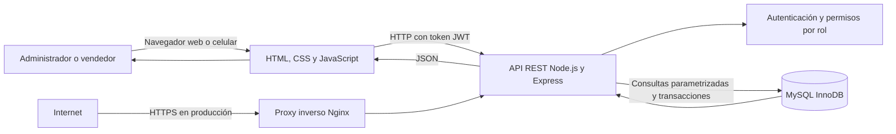
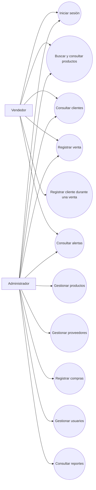
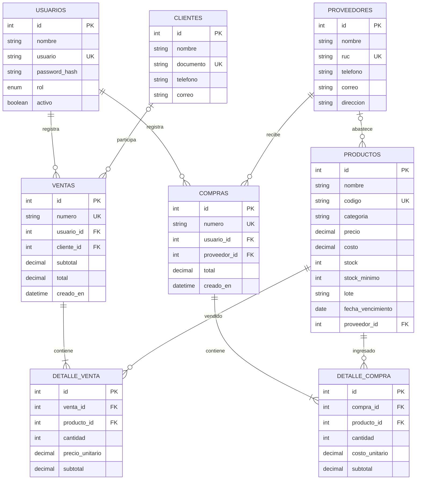
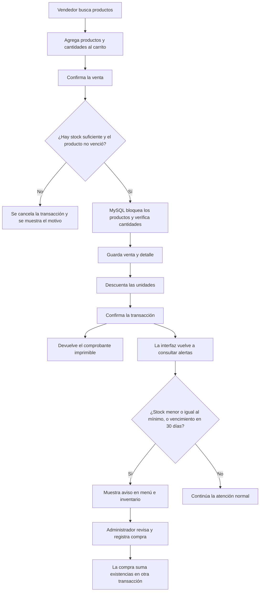

# Propuesta de software web para la botica Nova Salud

## Tema

Implementación de un software web de gestión de inventario y venta para la botica Nova Salud. En las preguntas guía del caso, el nombre FarmaPlus se refiere a esta misma botica.

## Objetivo

Implementar una aplicación web centralizada para registrar productos, compras y ventas, consultar el stock disponible y avisar cuando haya productos con pocas unidades o próximos a vencer. Se busca reducir errores de registro y ayudar a atender al cliente con menos pasos.

La aplicación se puede abrir desde una computadora o un celular con navegador. Para esta primera versión se utiliza HTML, CSS y JavaScript en la interfaz, una API REST hecha con Node.js y Express, y MySQL para guardar los datos.

## Situación actual

Nova Salud ha aumentado sus clientes, pero el inventario y la atención se controlan manualmente. Un registro escrito puede quedar desactualizado cuando se vende un producto, y revisar productos uno por uno toma tiempo. Esto hace más difícil saber qué medicamentos están disponibles, cuáles se deben reponer y cuáles están próximos a vencer.

La solución propuesta centraliza los registros. Cuando se confirma una venta, el sistema valida el stock y el vencimiento, guarda la operación y descuenta las unidades en una transacción. Cuando el administrador registra una compra, las unidades recibidas se suman al stock también con una transacción.

## Respuestas a las preguntas guía

### 1. ¿Cuáles son los principales desafíos operativos por no tener un sistema automatizado?

El principal problema es que el stock escrito puede no coincidir con las unidades que realmente están en la botica. También se puede vender un producto que ya se agotó, no pedir a tiempo los productos más solicitados o encontrar tarde un lote vencido.

La búsqueda manual alarga la atención, sobre todo cuando hay varias personas esperando. Además, cuesta conocer las ventas del día, identificar los productos más vendidos y revisar quién registró cada operación. Si se comete un error al copiar una cantidad, puede ser difícil encontrar en qué momento ocurrió.

### 2. ¿Qué características debe incluir el software web?

La aplicación propuesta incluye un acceso con usuario y contraseña. Las contraseñas se guardan con hash bcrypt y el inicio de sesión entrega un token JWT. El administrador puede gestionar productos, proveedores, compras, usuarios y reportes. El vendedor puede atender ventas y consultar productos y clientes. Los permisos se verifican en el servidor, no solamente ocultando botones.

El catálogo de productos guarda nombre, código, categoría, precio, costo, stock, stock mínimo, lote, vencimiento y proveedor. Se puede buscar por nombre o código; los productos con stock igual o menor al mínimo se muestran como stock bajo.

La pantalla de venta permite buscar productos, agregarlos a un carrito, asociar un cliente existente o registrar uno durante la atención y emitir un comprobante interno imprimible. La venta no se confirma si falta stock o el producto está vencido. El comprobante sirve como constancia interna y no reemplaza un comprobante electrónico autorizado por SUNAT.

El módulo de alertas consulta los productos con stock bajo, vencidos o que vencerán dentro de 30 días. El aviso se actualiza cada minuto y también después de una venta. Los administradores pueden registrar compras para aumentar las existencias. Los reportes muestran las ventas de hoy, los cinco productos más vendidos en los últimos 30 días y el resumen de ventas de los últimos 7 días.

### 3. ¿Cómo ayuda el software a reducir el desabastecimiento y mejorar el servicio?

Cada venta confirmada descuenta las unidades en el momento. La transacción hace que el registro de la venta y el cambio de stock se guarden juntos: si una parte falla, se revierte la operación. Esto evita que una venta quede registrada sin descontar el producto, o que el stock se descuente sin guardar la venta.

Las alertas permiten que el administrador detecte con anticipación cuándo revisar o reponer un producto. La búsqueda rápida y el carrito reducen el tiempo que el vendedor dedica a consultar existencias y calcular el total. El sistema ayuda a decidir con datos, pero la reposición todavía depende de que una persona revise la alerta y registre la compra.

### 4. ¿Qué otros beneficios pueden mejorar la competitividad?

El historial de ventas permite reconocer qué productos tienen más movimiento y planificar mejor las compras. Los registros de clientes ayudan a mantener una atención ordenada, siempre usando sus datos con responsabilidad. El registro de usuario y fecha en ventas y compras también facilita revisar las operaciones del negocio.

Al tener una pantalla de atención común para el equipo, se reduce la dependencia de apuntes separados. El personal puede dedicar menos tiempo a buscar información y más tiempo a orientar al cliente. En el futuro, los datos de ventas podrían ayudar a planificar horarios de mayor demanda y negociar pedidos con proveedores.

### 5. ¿Qué métricas sirven para evaluar los resultados?

Antes de poner el sistema en uso se debe tomar una línea base durante dos semanas. Luego se comparan los resultados semanalmente durante el primer mes y mensualmente después. Las metas iniciales de la tabla son propuestas para el proyecto, no resultados garantizados.

| Métrica | Forma de cálculo | Fuente y frecuencia | Meta inicial |
|---|---|---|---|
| Tiempo de atención | Minutos desde que el cliente solicita un producto hasta que termina la atención; promedio de una muestra de atenciones | Cronometrar una muestra antes y después, semanalmente | Reducir el promedio al menos 20% al primer mes |
| Exactitud del inventario | Productos contados cuyo stock coincide con el sistema / productos contados x 100 | Conteo físico de una muestra, semanalmente | Alcanzar 98% de coincidencia |
| Diferencia de stock | Suma de diferencias absolutas entre conteo físico y sistema | Conteo físico y listado del sistema, semanalmente | Reducirla cada mes frente a la línea base |
| Quiebres de stock | Solicitudes que no se pudieron atender por falta del producto | Registrar manualmente las solicitudes no atendidas, cada semana | Reducirlas al menos 30% al segundo mes |
| Productos vencidos en anaquel | Unidades vencidas encontradas durante el conteo | Revisión física y alertas del sistema, semanalmente | No encontrar unidades vencidas disponibles para venta |
| Tiempo de reacción a alertas | Tiempo entre detectar una alerta y registrar la compra de reposición | Registrar fecha de revisión y fecha de compra en una hoja de seguimiento | Revisar las alertas el mismo día hábil |
| Ventas registradas | Cantidad e importe de las ventas registradas por día | Reporte del sistema, diariamente | Revisar que las ventas atendidas queden registradas |

El sistema ya entrega reportes de ventas y alertas, pero no guarda el tiempo de espera del cliente, las solicitudes no atendidas ni el tiempo entre alerta y compra. Esas medidas se deben recoger con observación o una hoja de seguimiento. No se deben presentar como datos calculados automáticamente por esta versión.

## Aplicación de los conocimientos del curso

### Interfaz web

Se aplican HTML para la estructura de pantallas y formularios, CSS para el diseño adaptable y JavaScript para la búsqueda, el carrito, los mensajes y la comunicación con la API. La pantalla de venta se prioriza porque es la tarea diaria más frecuente. Los formularios validan campos básicos en el navegador, pero el servidor vuelve a validar los datos.

### Backend y API REST

Node.js y Express reciben las solicitudes del navegador. La API separa rutas de autenticación, productos, ventas, compras, clientes, proveedores, usuarios, alertas y reportes. Los métodos HTTP expresan la acción: por ejemplo, POST registra una venta y GET consulta productos. El middleware comprueba el token JWT y el rol antes de permitir operaciones protegidas.

### Base de datos

MySQL guarda los datos en tablas relacionadas mediante claves primarias y foráneas. Las tablas principales son usuarios, clientes, proveedores, productos, ventas, detalle_venta y compras. También se utiliza detalle_compra para registrar los productos de cada compra. Las tablas usan InnoDB para permitir transacciones.

Las consultas reciben parámetros para reducir el riesgo de inyección SQL. Las transacciones de venta y compra mantienen consistentes el encabezado, sus detalles y el stock. El índice de búsqueda y los índices de fecha ayudan a las consultas habituales.

### Seguridad y trabajo en equipo

Las contraseñas se procesan con bcrypt; no se guardan como texto legible. JWT permite identificar la sesión y el middleware verifica el rol en cada ruta protegida. Helmet agrega cabeceras de seguridad, CORS restringe el origen permitido y el login tiene un límite de intentos. El archivo `.env` se usa para la configuración local y no se debe subir a GitHub.

Git y GitHub se aplican para guardar el historial del código, trabajar con cambios identificables y compartir el proyecto. Antes de publicar una versión se deben revisar los cambios, ejecutar la aplicación y comprobar que las operaciones principales funcionen.

## Arquitectura del sistema

El navegador usa la interfaz para enviar solicitudes HTTP a Express. Express valida los datos, autentica al usuario y aplica los permisos. Después consulta MySQL y devuelve una respuesta en JSON. En una instalación publicada, el acceso externo debe pasar por HTTPS; la base de datos no se expone directamente a Internet.

## Casos de uso

El vendedor inicia sesión, consulta el catálogo, registra una venta, puede crear el cliente desde la pantalla de venta y consulta las alertas. El administrador realiza esas tareas y además mantiene productos, proveedores, compras y usuarios, y consulta los reportes. El comprador o proveedor no inicia sesión en esta versión; el administrador registra sus datos y las compras recibidas.

## Modelo de base de datos

El modelo guarda quién registra cada venta o compra. Una venta tiene uno o más detalles, y cada detalle se relaciona con un producto. Una compra pertenece a un proveedor y también contiene detalles para identificar qué cantidades ingresaron. El cliente de una venta es opcional.

## Flujo de una venta y alerta de reposición

Las alertas no se guardan en una tabla aparte: se calculan consultando el stock mínimo y la fecha de vencimiento de cada producto. La interfaz actualiza el aviso cada minuto y después de confirmar una venta.

## Despliegue

Para compartir el proyecto se puede crear un repositorio privado o público en GitHub. Se suben el código, `database.sql`, `package.json`, `package-lock.json` y `.env.example`. No se suben `.env`, contraseñas, tokens ni copias reales de la base de datos. El repositorio debe incluir instrucciones para instalar dependencias y ejecutar el seed de demostración.

En la nube se necesita un servidor que ejecute Node.js y una instancia MySQL. Express puede servir la interfaz y la API desde el mismo proyecto. Un proxy inverso como Nginx recibe las conexiones públicas y las dirige a Node.js. El dominio debe usar HTTPS con un certificado válido, por ejemplo, emitido y renovado con Let's Encrypt. El puerto de MySQL debe permanecer accesible solo desde el servidor de la aplicación o desde la red privada.

La configuración de producción se guarda en variables de entorno del servidor. Se debe reemplazar la clave JWT de ejemplo por un secreto aleatorio, crear un usuario MySQL con permisos limitados y establecer el origen CORS del dominio real. Los accesos de demostración se cambian antes de usar datos reales.

Se recomienda hacer una copia diaria de MySQL, cifrarla y guardarla fuera del servidor principal. Como punto de partida, se pueden conservar siete copias diarias y cuatro semanales, ajustando el tiempo a las necesidades del negocio. Una vez al mes se debe probar la restauración en una base separada. Una copia que nunca se ha restaurado no permite confirmar que se pueda recuperar.

El despliegue debe incluir una prueba de inicio de sesión con ambos roles, una venta de prueba, una compra de prueba, consulta de alertas y revisión de reportes. También se debe comprobar que una venta sin stock o de un producto vencido sea rechazada.

## Normas técnicas, seguridad y privacidad

El proyecto usa una API REST, validación de datos en servidor, consultas SQL parametrizadas, claves foráneas y transacciones. Como guía de calidad se puede utilizar ISO/IEC 25010 para revisar seguridad, usabilidad, confiabilidad y compatibilidad. Para accesibilidad se toma WCAG 2.2 como referencia para etiquetas claras, uso desde teclado, mensajes entendibles, contraste y adaptación a móviles; esta propuesta no afirma que la aplicación ya tenga certificación de conformidad.

OWASP Top 10 y OWASP ASVS sirven como guías para revisar riesgos y controles de una aplicación web. En el sistema se aplican bcrypt para contraseñas, JWT con vencimiento, control de roles en el servidor, límite de intentos de login, Helmet, CORS configurado, validación de entradas y consultas con parámetros. En producción, HTTPS es obligatorio para proteger credenciales y tokens durante el tránsito.

Los datos de clientes, como nombre, documento, teléfono o correo, son datos personales. La botica debe definir para qué los recoge, limitar el acceso, conservar solo los necesarios y atender las obligaciones que correspondan bajo la Ley N.° 29733 y su reglamento vigente. Para el trabajo se deben usar datos ficticios. El token de esta versión se guarda en el navegador; por eso también se debe evitar incluir scripts no confiables y revisar la protección frente a ataques de navegador antes de tratar información real.

El comprobante que imprime esta aplicación es interno. Si el negocio necesita emitir comprobantes electrónicos, se debe integrar y validar ese proceso con los requisitos de SUNAT; no forma parte de este alcance.

## Seguridad y salud en el trabajo

La aplicación es una herramienta de trabajo y no reemplaza las medidas de seguridad de la botica. Para el uso de computadoras se recomienda mantener una postura cómoda, ubicar la pantalla a una altura adecuada, contar con iluminación suficiente, ordenar cables y conexiones eléctricas, y realizar pausas para reducir fatiga visual y muscular. Los equipos deben mantenerse lejos de líquidos y de zonas donde se almacenen productos que puedan dañarlos.

La organización puede considerar la Ley N.° 29783 de Seguridad y Salud en el Trabajo y su reglamento, aprobado por el D.S. N.° 005-2012-TR, al definir sus procedimientos. Si se realiza un trabajo de instalación o mantenimiento eléctrico, debe hacerlo personal capacitado y siguiendo las medidas internas de seguridad.

## Cuidado del medio ambiente

El registro digital reduce el uso de cuadernos y hojas sueltas. Se imprime el comprobante solo cuando el cliente lo requiere y se apaga o suspende el equipo al terminar la jornada. Los equipos que ya no se puedan usar deben entregarse a un sistema autorizado de manejo de residuos de aparatos eléctricos y electrónicos, de acuerdo con las reglas aplicables, en lugar de mezclarlos con residuos comunes.

El control de vencimientos ayuda a detectar productos antes de que caduquen, pero no autoriza a venderlos ni a desechar medicamentos de cualquier manera. La botica debe separar los productos vencidos y seguir el procedimiento sanitario y ambiental que corresponda para su devolución o disposición.

## Conclusiones

La propuesta responde al problema principal de Nova Salud: la falta de una fuente única y actualizada para consultar existencias y registrar operaciones. La pantalla de venta, la búsqueda rápida y el registro automático del stock buscan hacer más ordenada la atención.

Las transacciones protegen la consistencia de las ventas, compras y cantidades. Las alertas permiten detectar existencias bajas y fechas próximas de vencimiento, mientras que los reportes entregan información para revisar el movimiento del negocio.

El software aporta una herramienta para reducir errores y mejorar el servicio, pero el resultado también depende de registrar correctamente las compras, revisar las alertas, hacer conteos físicos y capacitar al personal. La medición antes y después permitirá saber si los tiempos y las diferencias de inventario realmente mejoran.

## Referencias para consulta

- W3C, Web Content Accessibility Guidelines (WCAG) 2.2: https://www.w3.org/TR/WCAG22/
- OWASP, Application Security Verification Standard: https://owasp.org/www-project-application-security-verification-standard/
- OWASP, Top 10: https://owasp.org/www-project-top-ten/
- Ley N.° 29733, Ley de Protección de Datos Personales, y reglamento vigente.
- Ley N.° 29783, Ley de Seguridad y Salud en el Trabajo, y D.S. N.° 005-2012-TR.
- Ley N.° 28611, Ley General del Ambiente, y normativa aplicable al manejo de residuos de aparatos eléctricos y electrónicos.